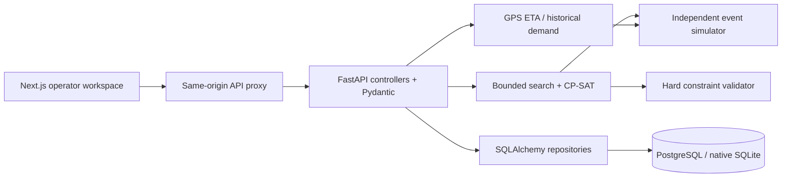

# Architecture

## Boundaries

`apps/web/components` owns interface state and presentation. `lib/api.ts` provides typed communication and Zod scenario validation. TanStack Query manages request/loading/error state. No transport-domain optimization runs in the browser. The SVG map projects geographic observations back to fictional campus drawing coordinates.

`services/api/app/main.py` validates inputs, loads snapshots, invokes domain modules and persists results. No event simulation is implemented in a request handler. API docs are available at `/docs`, machine schema at `/openapi.json`.

`domain.py` defines Pydantic domain contracts; `responses.py` defines full API response schemas. Frontend domain and response types are generated from `data/openapi.json` into `apps/web/lib/generated.ts`. `seed.py` constructs connected directed network and fixed timetable. `constraints.py` checks immutable timetable windows, capacities, connected routes, availability, minimum service and physically feasible duties. `simulation.py` owns passenger/vehicle ground truth. `demand.py` and `eta.py` perform forecasting and independent held-out evaluation. `optimization.py` owns candidate generation, CP-SAT assignments and planning-only selection.

`persistence.py` owns SQLAlchemy storage, transactions, idempotent seeding, immutable runs, history and append-only operator decisions. Entities are typed versioned JSON documents with indexed kind/organization identifiers rather than a deeply normalized relational network schema. Their shape is validated by domain contracts. Runs embed all inputs so old experiments survive future seed resets. Alembic owns schema changes.

## Execution and lifecycle

Docker waits for PostgreSQL, applies migrations, seeds missing entities, starts FastAPI, then starts Next.js. Native startup follows the same order using SQLite. Requests are synchronous threadpool operations. At most two optimizations run simultaneously per process; each request has numeric limits, a maximum of 50 requested candidates, 60 trips and a 30-second search budget. Evaluation can add runtime beyond the search budget. A small LRU cache avoids recomputing identical dashboards; cache keys include full scenario, network and plan snapshots.

Single-campus demo mode has no login. Organization ownership is present in database rows, but tenant isolation is not implemented. Ports bind to loopback. CORS is restricted to configured origins. Unexpected exceptions are logged server-side with a JSON event description and produce a generic client error, never an exception trace.

## Deployment

The supplied Compose configuration is local-demo infrastructure. Native commands are in README. Cloud deployment is optional: deploy the Next app on a Node-compatible service and the API on a Python container host with PostgreSQL. Set the proxy URL at frontend build time, configure CORS, add authentication and restrict API access before exposing it publicly. No hosted deployment is performed by this project.
